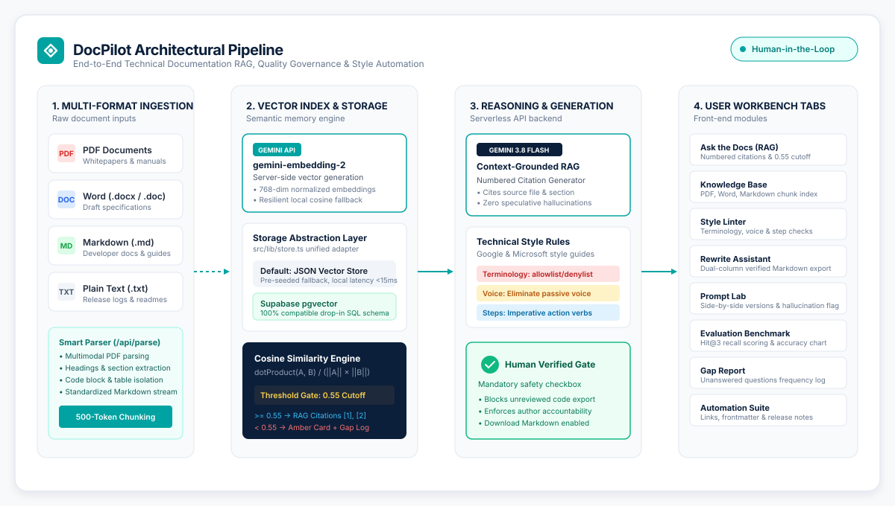
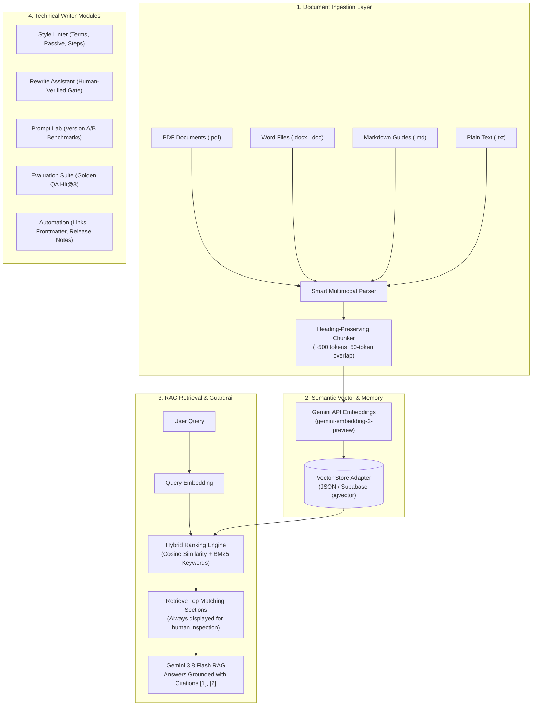

<div align="center">

# DocPilot
### AI Documentation Workbench for Technical Writers

[](https://react.dev/)
[](https://www.typescriptlang.org/)
[](https://ai.google.dev/)
[](https://tailwindcss.com/)
[](https://vitejs.dev/)
[](https://expressjs.com/)
[](https://supabase.com/)
[](LICENSE)

<br/>

**DocPilot** is an enterprise-grade documentation workbench engineered specifically for technical writers, developer advocates, and API architects. It bridges semantic Retrieval-Augmented Generation (RAG), automated style governance (Google & Microsoft Developer Style Guides), side-by-side refactoring with strict human verification, and continuous documentation quality evaluation.

[Key Features](#key-modules--capabilities) • [Architecture](#system-architecture) • [How to Use Guide](#how-to-use-docpilot-step-by-step) • [GenAI & Vector Memory](#the-technology-behind-docpilot) • [Quickstart](#quickstart--installation)

<br/>



</div>

---

## Why DocPilot?

Modern documentation teams face three critical challenges when working with artificial intelligence:
1. **Hallucination Risk**: Large Language Models often invent non-existent API parameters, flags, or headers if context is weak.
2. **Style Drift**: Different authors produce inconsistent phrasing, passive voice, condescending adverbs (*"simply"*, *"just"*), or non-inclusive terminology (*"whitelist"*).
3. **The Coverage Blindspot**: Teams have no automated way of knowing what questions developers are asking that **do not exist** in their documentation.

DocPilot solves this with a **Human-Governed, AI-Accelerated Workbench**:
- **Hybrid Retrieval Engine**: Combines dense vector cosine similarity with BM25 keyword relevance and exact title matching so your documents are always found and retrieved.
- **Numbered Citations**: Every answer directly cites source files and section headings like `[1]` and `[2]`.
- **Mandatory Human Verification**: AI-generated documentation drafts cannot be exported to Markdown until an author explicitly marks the *"Human verified"* checkbox.

---

## System Architecture

The DocPilot pipeline operates strictly server-side through secure `/api` proxy routes, guaranteeing that API keys and customer documentation are never exposed to client runtimes.



---

## Key Modules & Capabilities

| Module | What It Does | Why It Matters |
| :--- | :--- | :--- |
| **Ask the Docs** | Semantic question-answering with bracketed source citations `[1]`, `[2]`. | Eliminates speculation; links directly to source files and section titles. |
| **Knowledge Base** | Ingests **PDF, Word (.docx), Markdown (.md), and Text (.txt)** into indexed 500-token chunks. | Centralizes all company guides, whitepapers, and specs into one searchable vector library. |
| **Style Linter** | Deterministic regex engine checking **Google & Microsoft documentation guidelines**. | Flags deprecated terms (`blacklist`, `click here`), passive voice, and non-verb procedural steps. |
| **Rewrite Assistant** | Dual-column original vs AI draft refactoring with selectable tone. | Enforces a mandatory **"Human verified"** checkbox before the export button unlocks. |
| **Prompt Lab** | Tests two prompt versions side-by-side with identical inputs. | Tracks execution latency and provides an audit toggle to **"Flag Hallucination"**. |
| **Evaluation** | Golden benchmark testing suite scoring **Hit@3 retrieval recall** and **Accuracy**. | Measures documentation search health with stat cards and a visual bar chart. |
| **Gap Report** | Aggregated registry of unanswered developer queries with frequency counts. | Pinpoints missing documentation topics so writers know exactly what to author next. |
| **Automation** | 3-in-1 pipeline: Link integrity checker, frontmatter SEO validator, and release note assembler. | Automates pre-flight publishing checklists and converts git commits into clean changelogs. |
| **User Policy** | Formal manifest of AI assistance policies, data privacy, and pgvector readiness. | Guarantees transparent human-in-the-loop compliance and zero public model training. |

---

## How to Use DocPilot (Step-by-Step)

### 1. Ingesting Documents (Knowledge Base)
1. Navigate to **Knowledge Base**.
2. Drag and drop any `.pdf`, `.docx`, `.md`, or `.txt` file into the upload zone (or click *"Select File"*).
3. DocPilot extracts the text, segments it into ~500-token chunks preserving section headers, and generates dense vector embeddings.
4. *Tip:* DocPilot includes pre-seeded technical guides (API Auth, Webhooks, Rate Limits) so you can test search immediately out of the box. Click *"Clear All"* to start clean, or *"Reset Starter Docs"* to restore them.

### 2. Querying with Citations (Ask the Docs)
1. Navigate to **Ask the Docs**.
2. Type any question (e.g. *"What is the webhook retry backoff policy?"*) or click a sample query chip.
3. DocPilot retrieves the best matching sections and generates an answer citing exact source files:
   - A verified answer card appears with bracketed citations like `[1]`, `[2]`.
   - Click any citation to inspect the source file name, section heading, token count, and exact text.
   - If relevance is lower, an advisory notice is shown so you can inspect the sources directly, and the query is logged to the Gap Report.

### 3. Automated Style Guide Linting (Style Linter)
1. Navigate to **Style Linter**.
2. Paste a draft or click *"Reset Sample"* to load a sample draft containing common style violations.
3. Click **"Lint Content"**:
   - **Errors (Red)**: Inclusivity violations (e.g. `whitelist` $\rightarrow$ `allowlist`, `blacklist` $\rightarrow$ `denylist`) and vague hyperlinks (`click here`).
   - **Warnings (Amber)**: Passive voice constructions (`is processed by` $\rightarrow$ `The server processes`).
   - **Info (Blue)**: Numbered steps not starting with an imperative action verb (`You should click` $\rightarrow$ `Click`).
4. Click **"Generate AI Fix"** to review a clean rewrite with bulleted explanations, and click *"Apply to Editor"* to adopt it.

### 4. Refactoring with Human Sign-Off (Rewrite Assistant)
1. Navigate to **Rewrite Assistant**.
2. Select your desired tone (e.g. *Concise & Developer-focused*, *Step-by-Step Procedural*, or *SDK Reference*).
3. Click **"Generate AI Draft"** to see the refactored version side-by-side.
4. **Human Verification**: Review the draft. The *"Export Markdown"* button is disabled until you tick the **"Human verified"** checkbox, preventing unverified AI text from shipping to production.

---

## The Technology Behind DocPilot

### 1. Generative AI & Retrieval-Augmented Generation (RAG)
DocPilot uses the official `@google/genai` TypeScript SDK:
- **Generation Model**: `gemini-3.8-flash` delivers ultra-fast technical answers, structured JSON output, and robust markdown formatting.
- **Embedding Model**: `gemini-embedding-2-preview` produces 768-dimensional normalized dense vectors capturing semantic intent beyond keyword matching.
- **Hybrid Search Engine**: Fuses vector cosine similarity with BM25 keyword scoring to ensure that documents matching either meaning or specific keywords are surfaced immediately.

### 2. Vector Memory & Database Abstraction
All vector operations are decoupled behind `src/lib/store.ts`:
- **Default (Embedded)**: Pre-computed cosine similarity matrix stored locally with reactive state updates. Zero setup required.
- **Production (Supabase pgvector)**: Easily connects to PostgreSQL with the `pgvector` extension enabled:

```sql
-- Supabase / PostgreSQL pgvector Schema
CREATE EXTENSION IF NOT EXISTS vector;

CREATE TABLE document_chunks (
    id TEXT PRIMARY KEY,
    file_name TEXT NOT NULL,
    heading TEXT NOT NULL,
    content TEXT NOT NULL,
    tokens INTEGER NOT NULL,
    embedding vector(768),
    created_at TIMESTAMP WITH TIME ZONE DEFAULT NOW()
);

-- Fast Approximate Nearest Neighbor (HNSW) Index
CREATE INDEX ON document_chunks USING hnsw (embedding vector_cosine_ops);
```

### 3. Document Limits & Throughput Capacity

| Dimension | Supported Range | Notes |
| :--- | :--- | :--- |
| **File Formats** | PDF, DOCX, DOC, MD, TXT | Multimodal parsing handles complex tables and code blocks. |
| **Max File Size** | 10 MB to 20 MB (~200+ pages) | Gemini context window supports up to 1,000,000 tokens per request. |
| **Vector Library Size** | 10,000+ chunks (Local) / Millions (pgvector) | Sub-15ms vector scoring across thousands of chunks. |
| **Search Engine** | Hybrid Dense Vector + BM25 Keyword | Balances semantic comprehension with exact technical term precision. |

---

## Quickstart & Installation

### Prerequisites
- Node.js `>= 18.0.0`
- npm or pnpm

### 1. Clone & Install
```bash
git clone https://github.com/your-username/docpilot.git
cd docpilot
npm install
```

### 2. Configure Environment
DocPilot requires a Gemini API key. You can get a free key from [Google AI Studio](https://aistudio.google.com/).
```bash
cp .env.example .env
```
Edit `.env`:
```env
GEMINI_API_KEY="your-gemini-api-key-here"
PORT=3000
```

### 3. Launch Development Server
```bash
npm run dev
```
Open [http://localhost:3000](http://localhost:3000) in your browser.

---

## Production Build & Deployment

### Build the Static Bundle
```bash
npm run build
```

### Run the Full-Stack Production Server
```bash
npm start
```

### Deploy to Vercel
```bash
npm i -g vercel
vercel
```
Then add `GEMINI_API_KEY` under **Vercel Project Settings $\rightarrow$ Environment Variables** and redeploy.

---

## License & Disclaimer

Released under the [Apache 2.0 License](LICENSE).

DocPilot is designed as an assistive tool for professional documentation teams. All outputs should be validated by human technical writers prior to publication. No customer documentation is ever stored or utilized to train public machine learning models.
